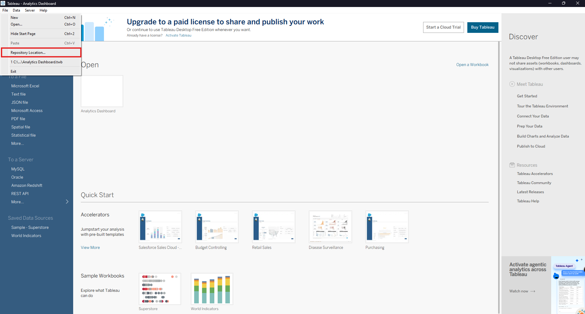
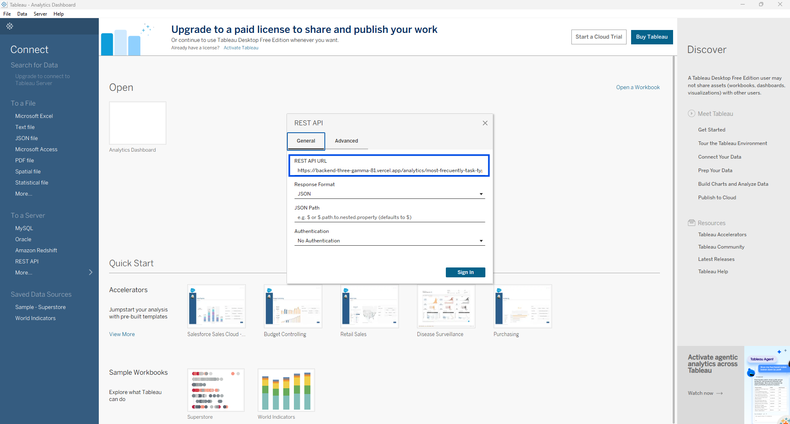
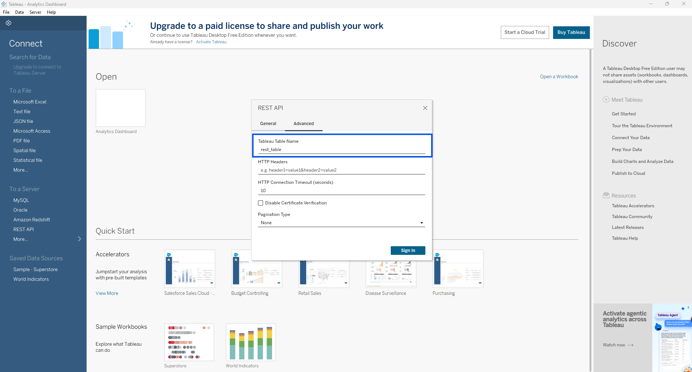

# Analytics Pipeline - Tableau Desktop

This repository uses Tableau to visualize backend analytics and telemetry data.
Each member keeps all their assigned business questions in one workbook and
imports the completed workbook into `Workbooks/Analytics Dashboard.twb` using
the included REST API connector.

## Contents

- [Requirements](#requirements)
- [Repository structure](#repository-structure)
- [1. Clone the repository](#1-clone-the-repository)
- [2. Install Tableau Desktop Free Edition](#2-install-tableau-desktop-free-edition)
- [3. Install the REST API JDBC driver](#3-install-the-rest-api-jdbc-driver)
- [4. Configure this clone as the Tableau repository](#4-configure-this-clone-as-the-tableau-repository)
- [5. Open your member workbook](#5-open-your-member-workbook)
- [6. Connect the member workbook to the REST API](#6-connect-the-member-workbook-to-the-rest-api)
- [7. Add completed work to the main dashboard](#7-add-completed-work-to-the-main-dashboard)
- [8. Commit the changes](#8-commit-the-changes)
- [Official Tableau references](#official-tableau-references)

## Requirements

- [Git](https://git-scm.com/downloads)
- [Tableau Desktop Free Edition](https://www.tableau.com/products/desktop-free/download)
  2026.2.3 or later
- [Tableau REST API JDBC driver](https://www.tableau.com/support/drivers)
- A free Tableau account

## Repository structure

| Path | Purpose |
| --- | --- |
| `Workbooks/Analytics Dashboard.twb` | Main dashboard containing the completed team visualizations. |
| `Workbooks/BQS-CRISTIAN.twb` | Cristian's assigned business questions. |
| `Workbooks/BQS-DIEGO.twb` | Diego's assigned business questions. |
| `Workbooks/BQS-MANUELA.twb` | Manuela's assigned business questions. |
| `Workbooks/BQS-SHAIEL.twb` | Shaiel's assigned business questions. |
| `Workbooks/BQS-VALERIA.twb` | Valeria's assigned business questions. |
| `Workbooks/BQS-VICTORIA.twb` | Victoria's assigned business questions. |
| `Connectors/tableau_rest-v1.0.1.taco` | REST API connector supporting JSON and CSV endpoints. |

## 1. Clone the repository

```powershell
git clone https://github.com/ISIS3510-Team12/Analytics-Pipeline.git
cd Analytics-Pipeline
```

## 2. Install Tableau Desktop Free Edition

1. Download Tableau Desktop from the link in [Requirements](#requirements).
2. Run the installer for Windows or macOS.
3. Start Tableau Desktop and select **Use Tableau for free**.
4. Sign in with a Tableau account, or create one when prompted.

## 3. Install the REST API JDBC driver

The `.taco` file included in the repository defines the REST API connector, but
the connector also requires Tableau's REST API JDBC driver.

1. Download the **REST API** JDBC driver from the
   [Tableau driver page](https://www.tableau.com/support/drivers).
2. Copy the downloaded `.jar` file into the driver folder for your operating
   system:
   - Windows: `C:\Program Files\Tableau\Drivers`
   - macOS: `~/Library/Tableau/Drivers`
3. Restart Tableau Desktop.

On Windows, copying the driver into `C:\Program Files` may require administrator
permission.

## 4. Configure this clone as the Tableau repository

Using the clone as the Tableau repository makes its workbooks and REST API
connector available in Tableau Desktop.

1. In Tableau Desktop, select **File > Repository Location**.

   Example:

   

2. Select the cloned `Analytics-Pipeline` folder containing this README. Do not
   select one of its subfolders. Before confirming, check that the selected
   folder contains both `Workbooks/` and `Connectors/`.
3. Close and restart Tableau Desktop.
4. Check that the setup is working: **REST API** should appear under
   **To a Server**, and **Analytics Dashboard** should be available under
   **Open**.

## 5. Open your member workbook

Each member has a dedicated workbook in `Workbooks/`. Add your assigned business
questions to your member workbook instead of editing `Analytics Dashboard.twb`
directly.

1. Select **File > Open** in Tableau Desktop.
2. Open the workbook matching your member name, such as
   `Workbooks/BQS-VALERIA.twb`.

Use the following categories to classify the business questions inside the
member workbook:

| Type | Business-question category |
| --- | --- |
| `TYPE1` | App telemetry |
| `TYPE2` | Direct user-experience improvement |
| `TYPE3` | New, deprecated, or updated features |
| `TYPE4` | Benefits derived from data |
| `TYPEMIX` | Combination of two or more types |

Name each worksheet inside the member workbook using the `TYPE-MEMBER`
convention. Example sheet name:

```text
TYPE1-MEMBER
```

## 6. Connect the member workbook to the REST API

1. Open the member workbook selected in the previous step.
2. Select **Data > New Data Source**.
3. Under **To a Server**, select **More**, then choose **REST API**.
4. Complete the **General** tab:
   - **REST API URL:** enter the full `https://` URL of the corresponding
     analytics or telemetry endpoint exposed by the backend.
   - **Response Format:** select **JSON**.
   - **Authentication:** select **No Authentication**.

   In the example below, enter the backend analytics or telemetry endpoint URL
   in the blue-highlighted **REST API URL** field:

   

5. Open the **Advanced** tab.
6. Under **Tableau Table Name**, replace the default `rest_table` value with the
   corresponding table or entity name returned by the endpoint, such as `users`
   or `tasks`.

   In the example below, replace the value in the blue-highlighted **Tableau
   Table Name** field with the corresponding backend table or entity name:

   

7. Select **Sign In**.
8. On the data-source page, add the renamed table to the canvas.
9. Open **Sheet 1** and build the visualization.

The connector is extract-only. To retrieve the latest backend data, select
**Data > Refresh All Extracts**.

## 7. Add completed work to the main dashboard

After completing the member workbook:

1. Save the completed member workbook.
2. Open `Workbooks/Analytics Dashboard.twb` in Tableau Desktop.
3. Select **File > Import Workbook**.
4. Choose the completed member workbook and select **Open**.
5. Confirm that its worksheets, dashboards, and data sources were imported.
6. Save `Analytics Dashboard.twb`.

Tableau imports the workbook's worksheets, dashboards, data sources,
calculations, parameters, sets, shapes, and colors. Keep sheet and data-source
names unique to prevent Tableau from automatically renaming duplicates.

## 8. Commit the changes

Commit-message example:

```text
feat: add POOKIE business-question sheets
```

## Official Tableau references

- [Download Tableau Desktop Free Edition](https://www.tableau.com/products/desktop-free/download)
- [Tableau edition comparison](https://help.tableau.com/current/pro/desktop/en-us/desktop_comparison.htm)
- [Tableau Desktop version compatibility](https://help.tableau.com/current/desktopdeploy/en-us/desktop_deploy_compatibility.htm)
- [Change the Tableau repository location](https://help.tableau.com/current/pro/desktop/en-us/environ_filesandfolders.htm)
- [REST API Connector on Tableau Exchange](https://exchange.tableau.com/products/1111)
- [Tableau JDBC driver requirements](https://tableau.github.io/connector-plugin-sdk/docs/drivers)
- [Copy sheets and data sources between workbooks](https://help.tableau.com/current/pro/desktop/en-us/copy_b_wkbks.htm)
